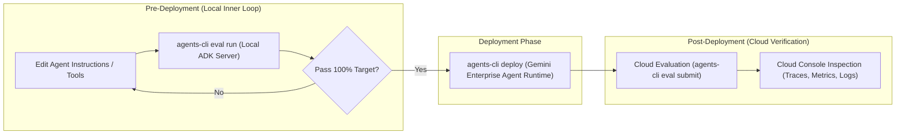

# CampSeeker 🏕️

An evidence-grounded **US National Park Service (NPS)** campground discovery and comparison agent built with [Google ADK](https://adk.dev/) (Agent Development Kit), Gemini, and the official [National Park Service API](https://www.nps.gov/subjects/developer/get-started.htm).

Prepared by **[Sandra Lopez-Zamora](https://www.linkedin.com/in/slopezza/)** ([Pythian](https://www.pythian.com/)) for **Google DevFest Windsor 2026**.

---

## 🌟 Overview

**CampSeeker** helps campers discover, evaluate, and compare US National Park campgrounds based strictly on verified NPS data. Rather than hallucinating amenities or dates, CampSeeker adheres to strict grounding principles:

- 🔍 **Park Discovery**: Searches NPS units by name, keyword, or US state postal code (e.g., `ME` for Maine, `CA` for California).
- ⛺ **Campground Inspection**: Fetches campground details including amenities (toilets, showers, water, RV hookups), operating hours, seasonal exceptions, fees, and official reservation links.
- ⚠️ **Park Alerts & Safety**: Retrieves active park advisories, road closures, and hazard warnings before recommending a stay.
- 🛡️ **Evidence-Grounded Guardrails**:
  - Strictly relies on tool outputs for park and campsite facts.
  - Preserves missing, unknown, or seasonal attributes as uncertainty rather than assuming yes/no.
  - Never hallucinates source links or claims to book campsites (read-only assistant).
  - Handles requirement changes dynamically (e.g. updating preferences filters previous recommendations).
- 🤝 **A2A (Agent-to-Agent) Protocol Ready**: Exposes standard A2A routes for interoperability with multi-agent networks.

---

## 🧰 Core Tools & Architecture 

If you are new to Google's agent development ecosystem, here is a quick overview of the key technologies and frameworks used throughout this project:

- **[Google ADK (Agent Development Kit)](https://adk.dev/)**:
  Google's open-source framework and Python SDK for building production-grade AI agents. ADK provides core primitives for configuring agents (`Agent`), declaring function tools, defining system instructions, managing session state/memory, and streaming model responses. In CampSeeker, ADK orchestrates the agent's reasoning loop and tool calling.
- **[`agents-cli` (Google Agents CLI)](https://cloud.google.com/products/agent-builder)**:
  An all-in-one developer command-line tool for Google agents. It streamlines the full development lifecycle: scaffolding projects, installing dependencies (`agents-cli install`), launching a local browser playground with live tool-call inspection (`agents-cli playground`), executing offline LLM evaluations (`agents-cli eval`), and managing cloud deployments.
- **[Gemini Enterprise Agent Platform](https://cloud.google.com/) & Gemini Models**:
  Google Cloud's enterprise infrastructure for running Gemini models (such as `gemini-2.5-flash`). It offers enterprise-grade security, IAM-based Application Default Credentials (ADC), low latency, and built-in Cloud Trace/Logging observability. *(Note: For local experimentation without a GCP project, developers can also use [Google AI Studio](https://aistudio.google.com/) with a free `GEMINI_API_KEY`).*
- **[A2A (Agent-to-Agent) Protocol](https://a2a-protocol.org/)**:
  An open standard enabling autonomous AI agents to discover, negotiate, and collaborate across systems. CampSeeker implements standard A2A endpoints and serves an Agent Card (`.well-known/agent-card.json`), allowing it to seamlessly act as a specialist subagent in multi-agent workflows.
- **[US National Park Service (NPS) API](https://www.nps.gov/subjects/developer/get-started.htm)**:
  The authoritative public REST API providing real-time data on all 400+ national parks, campgrounds, amenities, and park alerts. CampSeeker queries this API dynamically so all recommendations are grounded in official records.
- **[uv](https://docs.astral.sh/uv/)**:
  An extremely fast Python package and project manager written in Rust. It manages project dependencies, lockfiles (`uv.lock`), and virtual environments seamlessly.

---

## 📁 Project Structure

```text
campseeker/
├── campseeker/                    # Core agent package
│   ├── agent.py                  # ADK Root Agent and App entry points
│   ├── instructions.py           # Grounded system instructions & guardrails
│   ├── tools.py                  # Function tools (search_parks, get_campgrounds, get_alerts)
│   ├── client.py                 # Resilient, read-only NPS API client (supports transport injection)
│   ├── config.py                 # Environment and configuration loading
│   ├── fast_api_app.py           # FastAPI server with A2A routes and ADK runner
│   └── app_utils/                # Telemetry and A2A protocol helpers
├── tests/
│   ├── unit/                     # Offline unit test suite
│   │   └── test_campseeker.py    # Config validation, client error handling, tools, & agent setup
│   ├── integration/              # Integration and end-to-end server tests
│   │   ├── test_agent.py         # ADK streaming runner integration test
│   │   └── test_server_e2e.py    # FastAPI /run_sse and A2A JSON-RPC e2e test
│   └── eval/                     # Evaluation datasets and quality metrics
│       ├── datasets/             # Domain eval cases (basic-dataset.json)
│       ├── eval_config.yaml      # Evaluation runner configuration
│       └── response_quality.py   # LLM-as-judge rubric (grounding, boundaries, uncertainty)
├── .env.example                  # Environment variable template
├── agents-cli-manifest.yaml      # agents-cli configuration manifest
├── pyproject.toml                # Project metadata and dependencies (managed with uv)
└── README.md                     # Project documentation
```

---

## 📋 Requirements

- **Python**: `>= 3.11, < 3.14`
- **[uv](https://docs.astral.sh/uv/)**: Fast Python package manager
- **[agents-cli](https://cloud.google.com/products/agent-builder)**: Google Agents CLI (`uv tool install google-agents-cli`)
- **[NPS API Key](https://www.nps.gov/subjects/developer/get-started.htm)**: Free instant API key from the National Park Service
- **Gemini Platform Credentials**:
  - Google Cloud project with Gemini Enterprise enabled (with [Application Default Credentials](https://cloud.google.com/docs/authentication/provide-credentials-adc)), **or**
  - A [Google AI Studio API Key](https://aistudio.google.com/) (`GEMINI_API_KEY`)

---

## 🚀 Quick Start

### 1. Install Dependencies

Install `agents-cli` and project dependencies using `uv`:

```bash
# Setup agents-cli tooling (if not already installed)
uvx google-agents-cli setup

# Install project dependencies
agents-cli install
# or directly via uv:
uv sync
```

### 2. Configure Environment Variables

Copy `.env.example` to `.env` and fill in your keys:

```bash
cp .env.example .env
```

Edit `.env`:

```dotenv
# --- Gemini Configuration ---
# Option A: Gemini Enterprise Agent Platform (default)
GOOGLE_GENAI_USE_ENTERPRISE=true
GOOGLE_CLOUD_PROJECT=your-gcp-project-id
GOOGLE_CLOUD_LOCATION=global
GEMINI_MODEL=gemini-2.5-flash

# Option B: Google AI Studio
# GEMINI_API_KEY=your-gemini-api-key

# --- National Park Service API ---
NPS_API_KEY=your-nps-api-key
NPS_TIMEOUT_SECONDS=15
```

> 🔑 Get a free NPS API key at [nps.gov/subjects/developer/get-started.htm](https://www.nps.gov/subjects/developer/get-started.htm).

### 3. Launch Development Playground

Start the interactive ADK playground with hot reload:

```bash
agents-cli playground
```

Or run via the ADK CLI directly:

```bash
uv run adk web .
```

Open [http://localhost:8000](http://localhost:8000) (or the port indicated in terminal) to test conversations and inspect tool calls in the browser.

---

## 🛠️ Available Tools

CampSeeker equips the model with three specialized functions defined in [`campseeker/tools.py`](campseeker/tools.py):

| Tool | Description | Key Arguments |
| :--- | :--- | :--- |
| `search_parks` | Finds NPS park units and retrieves their 4-letter park code (e.g. `acad` for Acadia). | `query` (park name/keyword), `state_code` (e.g. `ME`, `VA`), `limit`, `start` |
| `get_campgrounds` | Fetches campgrounds, operating hours, amenities, hookups, and reservation URLs. | `park_code` (e.g. `acad`), `limit`, `start` |
| `get_alerts` | Retrieves published park closures, hazard warnings, and alerts to check for visit impacts. | `park_code` (e.g. `acad`), `limit`, `start` |

---

## 💬 Example Queries to Try

- *"Find campgrounds in Acadia National Park for next September with flush toilets and tent sites."*
- *"I'm planning a camping trip to Virginia in October. What parks have campgrounds that accommodate RVs?"*
- *"Are there any active closures or safety alerts affecting campgrounds in Great Smoky Mountains?"*
- *"Compare Blackwoods and Seawall campgrounds in Acadia — what are the differences in shower availability and fees?"*
- *"Can you book a site for me at Blackwoods?"* *(Tests read-only boundary enforcement and reservation URL citation)*

---

## 🧪 Testing and Evaluation

### Unit Tests

Unit tests run completely offline without needing live external networks or API credentials, utilizing transport injection for the NPS client:

```bash
uv run pytest tests/unit
```

Coverage includes:
- **Configuration**: Environment loading, missing key handling, timeout range validation.
- **NPS Client**: Input validation (postal codes, 4-character park codes, limits/offsets), response parsing, pagination metadata, and error handling (`NPSFailure`, rate limiting).
- **Tools**: Field filtering and keyword argument propagation for `search_parks`, `get_campgrounds`, and `get_alerts`.
- **Agent Definition**: Verification of root agent name, tools registration, and grounded instructions.

### Integration Tests

Integration tests verify live ADK streaming responses and full server end-to-end execution:

```bash
# Run agent streaming and FastAPI/A2A server tests
uv run pytest tests/integration
```

### Agent Evaluation (LLM-as-Judge)

CampSeeker includes custom evaluation datasets and automated LLM-as-judge quality metrics in [`tests/eval/`](tests/eval/) to evaluate grounding, constraints, and read-only boundaries.

#### 1. Prerequisites for Running Evals

1. **Install or update `agents-cli` (v1.15.0+)**:
   ```bash
   uv tool install google-agents-cli
   # or upgrade if already installed:
   uv tool upgrade google-agents-cli
   ```
2. **Project dependencies**:
   ```bash
   uv sync
   ```
3. **Environment setup (`.env`)**:
   Ensure `.env` contains your NPS API key and Gemini model credentials (either GCP project with ADC or `GEMINI_API_KEY`):
   ```dotenv
   GOOGLE_GENAI_USE_ENTERPRISE=true
   GOOGLE_CLOUD_PROJECT=your-gcp-project-id
   GOOGLE_CLOUD_LOCATION=global
   GEMINI_MODEL=gemini-2.5-flash
   NPS_API_KEY=your-nps-api-key
   ```

#### 2. Run the Evaluation Suite

Run the full evaluation workflow (inferencing all test cases + LLM-as-judge grading):

```bash
agents-cli eval run
```

What happens under the hood:
1. **Inference Phase (`eval generate`)**:
   - Automatically boots a local ADK FastAPI server on a loopback port (e.g. `http://127.0.0.1:18080`) under `app_name=campseeker`.
   - Sends each prompt from [`tests/eval/datasets/basic-dataset.json`](tests/eval/datasets/basic-dataset.json) to the agent over `/run_sse`.
   - Records all streamed agent messages and NPS tool-execution traces to `artifacts/traces/traces_<timestamp>.json`.
2. **Grading Phase (`eval grade`)**:
   - Evaluates the traces against the judge rubrics in [`tests/eval/eval_config.yaml`](tests/eval/eval_config.yaml).
   - Generates score summaries in the terminal, a structured JSON file, and an interactive HTML report.

#### 3. Inspecting Evaluation Results

After `eval run` completes, open the interactive HTML report in your browser to inspect turn-by-turn tool calls, agent responses, and judge rationales:

```bash
# Open the latest HTML report (macOS)
open $(ls -t artifacts/grade_results/results_*.html | head -n 1)

# Or on Linux:
# xdg-open $(ls -t artifacts/grade_results/results_*.html | head -n 1)
```

The report details:
- **Case-by-case breakdown**: Each test scenario, prompt, tool execution trajectory, and final answer.
- **Judge rationales**: Explanations for why each score was awarded.
- **Metrics summary**:
  - **`valid_trip_plan_rate`** ([`valid_trip_plan_rate.py`](tests/eval/valid_trip_plan_rate.py)): Binary pass/fail metric (Slide 9) verifying that the agent (a) honors all user constraints and (b) makes zero unsupported claims, targeting 100% across core cases.
  - **`custom_response_quality`** ([`response_quality.py`](tests/eval/response_quality.py)): 1–5 rubric judging evidence grounding in NPS data, read-only boundary compliance, uncertainty preservation, and absence of fabricated links.

#### 4. Advanced Evaluation Commands

- **Run inference only** (saves traces without grading):
  ```bash
  agents-cli eval generate
  ```
- **Re-grade existing traces** (offline without re-running the agent):
  ```bash
  agents-cli eval grade --traces artifacts/traces/traces_<timestamp>.json
  ```
- **Compare two evaluation runs** (verify improvements or detect regressions after prompt fixes):
  ```bash
  agents-cli eval compare artifacts/grade_results/results_run1.json artifacts/grade_results/results_run2.json
  ```

#### 5. Evaluation Dataset Coverage ([`basic-dataset.json`](tests/eval/datasets/basic-dataset.json))

The evaluation dataset codifies the presentation benchmark cases (DevFest Slides 9–10):
- `trip_constraint_maine_acadia_showers`: Progressive constraint narrowing (Maine ➔ Acadia) with strict verification of campground-level showers.
- `grounding_amenity_present`: Verification of verified facilities (flush toilets, dump stations) sourced directly from NPS API attributes.
- `grounding_amenity_missing`: Preserving unlisted attributes (e.g. Wi-Fi, satellite TV) as unknown/unverified rather than assuming.
- `grounding_no_supported_match`: Refusing to pad or invent options when requirements cannot be met by any campground.
- `grounding_availability_asked`: Enforcing read-only boundaries on booking requests and redirecting to official `reservationUrl`s.
- `active_alerts_check`: Surfacing park advisories without making false park-wide "all-clear" safety guarantees.

---

### 🚀 Pre-Deployment vs. Post-Deployment Evaluation

In production agent engineering, evaluation is not a one-time check. You evaluate both **before** and **after** deployment:



#### Why Evaluate Before Deployment?
- **Speed & Inner-Loop Agility**: Runs locally in seconds without building container images or deploying cloud infrastructure.
- **Cost & Quota Efficiency**: Uses your active model credentials without incurring cloud provisioning, container registry storage, or runner costs.
- **Rapid Regression Detection**: Immediately catches prompt wording issues, tool parameter schema errors, or rubric regressions before code is committed.

#### Why Evaluate After Deployment?
- **Real Runtime Environment**: Evaluates the actual production container running in Google Cloud rather than local simulation.
- **Live Authentication & IAM**: Validates that Cloud IAM roles, service accounts, and Secret Manager access (`NPS_API_KEY`) resolve properly under load.
- **Production Latency & Reliability**: Tests actual cloud networking, streaming stability (`:streamQuery` / `/run_sse`), and cold-start characteristics.
- **Auditable Quality Flywheel**: Creates persistent evaluation runs recorded in the Google Cloud Console for enterprise governance, auditing, and continuous improvement.

---

### ☁️ Post-Deployment Evaluation & Verification

Once your agent is deployed to **Gemini Enterprise Agent Runtime** (`deployment_metadata.json` is generated), run post-deployment evaluations and verify the deployment in Google Cloud.

#### 1. Submit Managed Evaluation to Gemini Enterprise Eval Service
Run evaluation directly against the live deployed Agent Runtime in Google Cloud using the managed Eval Service in Gemini Enterprise. The Eval Service requires a Google Cloud Storage (`gs://`) destination bucket to stage evaluation datasets and store grading artifacts:

```bash
# 1. Retrieve the deployed Agent Runtime resource ID from deployment_metadata.json
RESOURCE_NAME=$(python3 -c "import json; print(json.load(open('deployment_metadata.json'))['remote_agent_runtime_id'])")

# 2. Identify or create a GCS bucket for staging evaluation outputs
# Check existing buckets:
# gcloud storage buckets list --project <your-project-id>
# Or create a dedicated one in your deployment region (e.g., us-central1 or us-east1):
# gcloud storage buckets create gs://<your-gcs-bucket> --location=<your-region> --project=<your-project-id>
EVAL_BUCKET="gs://<your-gcs-bucket>/eval"

# 3. Submit evaluation job to the Eval Service in Gemini Enterprise
# Ensure --region matches your deployed Agent Runtime region (e.g., us-central1, us-east1)
agents-cli eval submit \
  --dataset tests/eval/datasets/basic-dataset.json \
  --resource-name "$RESOURCE_NAME" \
  --dest "$EVAL_BUCKET" \
  --project "<your-project-id>" \
  --region "<your-region>"
```

To fetch and inspect the results once the cloud evaluation job completes:

```bash
# Fetch and inspect results (ensure --region matches the evaluation run region)
agents-cli eval results \
  --run-id "<run-resource-name>" \
  --project "<your-project-id>" \
  --region "<your-region>"
```

#### 2. Run CLI Evaluation Against the Live Cloud Endpoint
You can also run your local evaluation command pointing directly to the deployed Agent Runtime HTTP endpoint:

```bash
# Run eval suite against the live cloud instance
agents-cli eval run \
  --url "https://<your-region>-aiplatform.googleapis.com/reasoningEngines/v1/${RESOURCE_NAME}/api" \
  --app-name campseeker
```

---

### 🔍 What to Check in Gemini Enterprise / Google Cloud Console

When reviewing your deployed agent in the Google Cloud Console, check the following key surfaces:

| Console Surface | Where to Find It | What to Inspect |
| :--- | :--- | :--- |
| **Agent Runtime** | **Gemini Enterprise** ➔ **Agent Runtime** *(or Vertex AI ➔ Reasoning Engines)* | • **Overview**: Verify deployment state is Active and engine spec matches `campseeker`.<br>• **Playground**: Test live queries interactively in the browser UI.<br>• **Logs**: Inspect `reasoning_engine_stdout` and `reasoning_engine_stderr` for startup warnings, session creation, and tool dispatch. |
| **Agent Evaluation** | **Gemini Enterprise** ➔ **Agent Evaluation** *(or Vertex AI ➔ Model Evaluation)* | • **Evaluation Runs**: View historical and current evaluation experiments.<br>• **Metrics Dashboard**: Review radar charts, `valid_trip_plan_rate`, and `custom_response_quality` distributions.<br>• **Trajectory Analysis**: Compare user prompts, tool call chains, final responses, and LLM-as-judge rationales side-by-side. |
| **Cloud Trace** | **Operations** ➔ **Cloud Trace** | • **End-to-End Spans**: Trace requests from initial user input through LLM inference down to each individual NPS tool call (`search_parks`, `get_campgrounds`, `get_alerts`).<br>• **Latency Analysis**: Identify performance bottlenecks between API queries and model generation.<br>• **Grounding Verification**: Inspect tool payloads to ensure evidence was passed accurately without hallucination. |
| **Secret Manager** | **Security** ➔ **Secret Manager** | • Verify `NPS_API_KEY` exists and has the appropriate IAM accessor binding for the agent's runtime service account. |
| **Agent Registry** | **Gemini Enterprise** ➔ **Agent Registry** | • If published via `agents-cli publish gemini`, verify the Agent Card metadata, name, description, and discoverability in multi-agent routing. |

---

### 📚 Further Documentation & Resources

- 📖 **[Gemini Enterprise Agent Runtime Overview](https://cloud.google.com/vertex-ai/docs/reasoning-engine/overview)**: Architecture, runtime contract, and deployment concepts.
- 🎯 **[Gemini Enterprise Agent Evaluation Service](https://cloud.google.com/vertex-ai/generative-ai/docs/models/evaluation-overview)**: Managed LLM-as-judge evaluation, dataset schemas, and evaluation metrics.
- 🛠️ **[Google Agent Development Kit (ADK) Documentation](https://adk.dev/)**: Building agents, function tools, sessions, and runners.
- 📦 **[Google Agents CLI (`agents-cli`) Guide](https://cloud.google.com/products/agent-builder)**: CLI commands for scaffolding, local playgrounds, evaluations, and deployments.
- 🌐 **[A2A (Agent-to-Agent) Protocol Specification](https://a2a-protocol.org/)**: Open standard for multi-agent interoperability and Agent Cards.
- 📈 **[Cloud Trace for Gen AI & Agents](https://cloud.google.com/trace/docs)**: Distributed tracing and observability for LLM reasoning loops.
- 🌲 **[National Park Service Developer Portal](https://www.nps.gov/subjects/developer/get-started.htm)**: NPS API reference, endpoints, query parameters, and data dictionaries.

---

## 🌐 FastAPI & A2A Protocol

CampSeeker includes a production-ready FastAPI app with [A2A (Agent-to-Agent)](https://a2a-protocol.org/) support:

```bash
uv run python -m campseeker.fast_api_app
```

- **FastAPI Endpoints**: Open API documentation is available at `http://localhost:8000/docs`.
- **A2A Endpoint**: Accessible under `/a2a/campseeker`. Use the [A2A Inspector](https://github.com/a2aproject/a2a-inspector) to test interoperability with other autonomous agents.

---

## 🚢 Deployment & CI/CD

Deploy to Google Cloud using `agents-cli`:

```bash
gcloud config set project <your-project-id>
agents-cli deploy
```

To add CI/CD pipelines and Terraform infrastructure:

```bash
agents-cli scaffold enhance
agents-cli infra cicd
```

---

## 📊 Observability

CampSeeker is pre-configured with OpenTelemetry exporters supporting:
- **Cloud Trace**: End-to-end latency and tool execution traces.
- **Cloud Logging**: Structured event logs.
- **BigQuery Agent Analytics**: Agent session analytics and quality monitoring.
