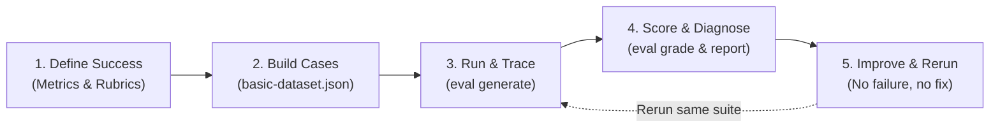
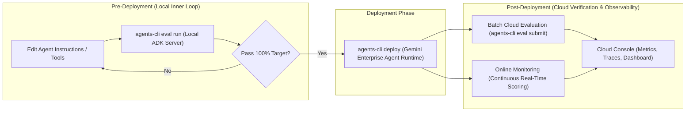

# CampSeeker 🏕️

An evidence-grounded **US National Park Service (NPS)** campground discovery and comparison agent built with [Google ADK](https://adk.dev/) (Agent Development Kit), Gemini, and the official [National Park Service API](https://www.nps.gov/subjects/developer/get-started.htm).

Prepared by **[Sandra Lopez-Zamora](https://www.linkedin.com/in/slopezza/)** ([Pythian](https://www.pythian.com/)) for **Google DevFest Windsor 2026**.

---

## 📑 Table of Contents

- [🌟 Overview](#overview)
- [🧰 Core Tools & Architecture](#core-tools-architecture)
- [📁 Project Structure](#project-structure)
- [📋 Requirements](#requirements)
- [🚀 Quick Start](#quick-start)
  - [1. Install Dependencies](#install-dependencies)
  - [2. Configure Environment Variables](#configure-environment-variables)
  - [3. Launch Development Playground](#launch-development-playground)
- [🛠️ Available Tools](#available-tools)
- [💬 Example Queries to Try](#example-queries)
- [🧪 Testing and Evaluation](#testing-and-evaluation)
  - [Unit Tests](#unit-tests)
  - [Integration Tests](#integration-tests)
  - [Agent Evaluation: The 5-Step Loop (LLM-as-Judge)](#agent-evaluation-llm-as-judge)
    - [Prerequisites for Running Evals](#eval-prerequisites)
    - [Step 1: Define Success (Metrics & Criteria)](#step-1-define-success)
    - [Step 2: Build Benchmark Cases (Evaluation Dataset)](#step-2-build-cases)
    - [Step 3: Run & Capture Observable Traces](#step-3-run-traces)
    - [Step 4: Score & Inspect Results (HTML Reports)](#step-4-score-results)
    - [Step 5: Diagnose, Improve & Rerun ("No Failure, No Fix")](#step-5-improve-rerun)
    - [Advanced Evaluation Commands](#advanced-eval-commands)
  - [🚀 Pre-Deployment vs. Post-Deployment Evaluation](#pre-vs-post-deployment-evaluation)
  - [☁️ Post-Deployment Evaluation & Verification](#post-deployment-evaluation)
    - [1. Submit Managed Evaluation to Eval Service](#submit-cloud-eval)
    - [2. Run CLI Evaluation Against Live Cloud Endpoint](#live-endpoint-eval)
    - [3. Set Up Continuous Online Monitoring](#online-monitoring)
  - [🔍 What to Check in Gemini Enterprise / Google Cloud Console](#console-inspection)
  - [📚 Further Documentation & Resources](#documentation-resources)
- [🌐 FastAPI & A2A Protocol](#fastapi-a2a-protocol)
- [🚢 Deployment & CI/CD](#deployment-cicd)
- [📊 Observability](#observability)

---

<a id="overview"></a>
## 🌟 Overview

**CampSeeker** helps campers discover, evaluate, and compare US National Park campgrounds based strictly on verified NPS data. Rather than hallucinating amenities or dates, CampSeeker adheres to strict grounding principles:

- 🔍 **Park Discovery**: Searches NPS units by name, keyword, or US state postal code (e.g., `ME` for Maine, `CA` for California).
- ⛺ **Campground Inspection**: Fetches campground details including amenities (toilets, showers, water, RV hookups), operating hours, seasonal exceptions, fees, and official reservation links.
- ⚠️ **Park Alerts & Safety**: Retrieves active park advisories, road closures, and hazard warnings before recommending a stay.
- 🛡️ **Evidence-Grounded Guardrails**:
  - Strictly relies on tool outputs for park and campsite facts.
  - Preserves missing, unknown, or seasonal attributes as uncertainty rather than assuming yes/no.
  - Never hallucinates source links or claims to book campsites (read-only assistant).
  - Handles requirement changes dynamically (e.g. updating preferences filters previous recommendations).
- 🤝 **A2A (Agent-to-Agent) Protocol Ready**: Exposes standard A2A routes for interoperability with multi-agent networks.

---

<a id="core-tools-architecture"></a>
## 🧰 Core Tools & Architecture

If you are new to Google's agent development ecosystem, here is a quick overview of the key technologies and frameworks used throughout this project:

- **[Google ADK (Agent Development Kit)](https://adk.dev/)**:
  Google's open-source framework and Python SDK for building production-grade AI agents. ADK provides core primitives for configuring agents (`Agent`), declaring function tools, defining system instructions, managing session state/memory, and streaming model responses. In CampSeeker, ADK orchestrates the agent's reasoning loop and tool calling.
- **[`agents-cli` (Google Agents CLI)](https://cloud.google.com/products/agent-builder)**:
  An all-in-one developer command-line tool for Google agents. It streamlines the full development lifecycle: scaffolding projects, installing dependencies (`agents-cli install`), launching a local browser playground with live tool-call inspection (`agents-cli playground`), executing offline LLM evaluations (`agents-cli eval`), and managing cloud deployments.
- **[Gemini Enterprise Agent Platform](https://cloud.google.com/) & Gemini Models**:
  Google Cloud's enterprise infrastructure for running Gemini models (such as `gemini-2.5-flash`). It offers enterprise-grade security, IAM-based Application Default Credentials (ADC), low latency, and built-in Cloud Trace/Logging observability. *(Note: For local experimentation without a GCP project, developers can also use [Google AI Studio](https://aistudio.google.com/) with a free `GEMINI_API_KEY`).*
- **[A2A (Agent-to-Agent) Protocol](https://a2a-protocol.org/)**:
  An open standard enabling autonomous AI agents to discover, negotiate, and collaborate across systems. CampSeeker implements standard A2A endpoints and serves an Agent Card (`.well-known/agent-card.json`), allowing it to seamlessly act as a specialist subagent in multi-agent workflows.
- **[US National Park Service (NPS) API](https://www.nps.gov/subjects/developer/get-started.htm)**:
  The authoritative public REST API providing real-time data on all 400+ national parks, campgrounds, amenities, and park alerts. CampSeeker queries this API dynamically so all recommendations are grounded in official records.
- **[uv](https://docs.astral.sh/uv/)**:
  An extremely fast Python package and project manager written in Rust. It manages project dependencies, lockfiles (`uv.lock`), and virtual environments seamlessly.

---

<a id="project-structure"></a>
## 📁 Project Structure

```text
campseeker/
├── campseeker/                    # Core agent package
│   ├── agent.py                  # ADK Root Agent and App entry points
│   ├── instructions.py           # Grounded system instructions & guardrails
│   ├── tools.py                  # Function tools (search_parks, get_campgrounds, get_alerts)
│   ├── client.py                 # Resilient, read-only NPS API client (supports transport injection)
│   ├── config.py                 # Environment and configuration loading
│   ├── fast_api_app.py           # FastAPI server with A2A routes and ADK runner
│   └── app_utils/                # Telemetry and A2A protocol helpers
├── tests/
│   ├── unit/                     # Offline unit test suite
│   │   └── test_campseeker.py    # Config validation, client error handling, tools, & agent setup
│   ├── integration/              # Integration and end-to-end server tests
│   │   ├── test_agent.py         # ADK streaming runner integration test
│   │   └── test_server_e2e.py    # FastAPI /run_sse and A2A JSON-RPC e2e test
│   └── eval/                     # Evaluation datasets and quality metrics
│       ├── datasets/             # Domain eval cases (basic-dataset.json)
│       ├── eval_config.yaml      # Evaluation runner configuration
│       └── response_quality.py   # LLM-as-judge rubric (grounding, boundaries, uncertainty)
├── .env.example                  # Environment variable template
├── agents-cli-manifest.yaml      # agents-cli configuration manifest
├── pyproject.toml                # Project metadata and dependencies (managed with uv)
└── README.md                     # Project documentation
```

---

<a id="requirements"></a>
## 📋 Requirements

- **Python**: `>= 3.11, < 3.14`
- **[uv](https://docs.astral.sh/uv/)**: Fast Python package manager
- **[agents-cli](https://cloud.google.com/products/agent-builder)**: Google Agents CLI (`uv tool install google-agents-cli`)
- **[NPS API Key](https://www.nps.gov/subjects/developer/get-started.htm)**: Free instant API key from the National Park Service
- **Gemini Platform Credentials**:
  - Google Cloud project with Gemini Enterprise enabled (with [Application Default Credentials](https://cloud.google.com/docs/authentication/provide-credentials-adc)), **or**
  - A [Google AI Studio API Key](https://aistudio.google.com/) (`GEMINI_API_KEY`)

---

<a id="quick-start"></a>
## 🚀 Quick Start

<a id="install-dependencies"></a>
### 1. Install Dependencies

Install `agents-cli` and project dependencies using `uv`:

```bash
# Setup agents-cli tooling (if not already installed)
uvx google-agents-cli setup

# Install project dependencies
agents-cli install
# or directly via uv:
uv sync
```

<a id="configure-environment-variables"></a>
### 2. Configure Environment Variables

Copy `.env.example` to `.env` and fill in your keys:

```bash
cp .env.example .env
```

Edit `.env`:

```dotenv
# --- Gemini Configuration ---
# Option A: Gemini Enterprise Agent Platform (default)
GOOGLE_GENAI_USE_ENTERPRISE=true
GOOGLE_CLOUD_PROJECT=your-gcp-project-id
GOOGLE_CLOUD_LOCATION=global
GEMINI_MODEL=gemini-2.5-flash

# Option B: Google AI Studio
# GEMINI_API_KEY=your-gemini-api-key

# --- National Park Service API ---
NPS_API_KEY=your-nps-api-key
NPS_TIMEOUT_SECONDS=15
```

> 🔑 Get a free NPS API key at [nps.gov/subjects/developer/get-started.htm](https://www.nps.gov/subjects/developer/get-started.htm).

<a id="launch-development-playground"></a>
### 3. Launch Development Playground

Start the interactive ADK playground with hot reload:

```bash
agents-cli playground
```

Or run via the ADK CLI directly:

```bash
uv run adk web .
```

Open [http://localhost:8000](http://localhost:8000) (or the port indicated in terminal) to test conversations and inspect tool calls in the browser.

---

<a id="available-tools"></a>
## 🛠️ Available Tools

CampSeeker equips the model with three specialized functions defined in [`campseeker/tools.py`](campseeker/tools.py):

| Tool | Description | Key Arguments |
| :--- | :--- | :--- |
| `search_parks` | Finds NPS park units and retrieves their 4-letter park code (e.g. `acad` for Acadia). | `query` (park name/keyword), `state_code` (e.g. `ME`, `VA`), `limit`, `start` |
| `get_campgrounds` | Fetches campgrounds, operating hours, amenities, hookups, and reservation URLs. | `park_code` (e.g. `acad`), `limit`, `start` |
| `get_alerts` | Retrieves published park closures, hazard warnings, and alerts to check for visit impacts. | `park_code` (e.g. `acad`), `limit`, `start` |

---

<a id="example-queries"></a>
## 💬 Example Queries to Try

- *"Find campgrounds in Acadia National Park for next September with flush toilets and tent sites."*
- *"I'm planning a camping trip to Virginia in October. What parks have campgrounds that accommodate RVs?"*
- *"Are there any active closures or safety alerts affecting campgrounds in Great Smoky Mountains?"*
- *"Compare Blackwoods and Seawall campgrounds in Acadia — what are the differences in shower availability and fees?"*
- *"Can you book a site for me at Blackwoods?"* *(Tests read-only boundary enforcement and reservation URL citation)*

---

<a id="testing-and-evaluation"></a>
## 🧪 Testing and Evaluation

<a id="unit-tests"></a>
### Unit Tests

Unit tests run completely offline without needing live external networks or API credentials, utilizing transport injection for the NPS client:

```bash
uv run pytest tests/unit
```

Coverage includes:
- **Configuration**: Environment loading, missing key handling, timeout range validation.
- **NPS Client**: Input validation (postal codes, 4-character park codes, limits/offsets), response parsing, pagination metadata, and error handling (`NPSFailure`, rate limiting).
- **Tools**: Field filtering and keyword argument propagation for `search_parks`, `get_campgrounds`, and `get_alerts`.
- **Agent Definition**: Verification of root agent name, tools registration, and grounded instructions.

<a id="integration-tests"></a>
### Integration Tests

Integration tests verify live ADK streaming responses and full server end-to-end execution:

```bash
# Run agent streaming and FastAPI/A2A server tests
uv run pytest tests/integration
```

<a id="agent-evaluation-llm-as-judge"></a>
### Agent Evaluation: The 5-Step Loop (LLM-as-Judge)

In accordance with the DevFest evaluation framework, CampSeeker uses a structured **5-step evaluation loop** to test agent behavior against observable tool traces and LLM-as-judge rubrics before deploying to users:



> 💡 **Note for DevFest Attendees:** The presentation slides (Slides 8, 11, 13, 20),  illustrate evaluation concepts using the underlying Python SDK calls (`client.evals.run_inference`, `client.evals.evaluate`, and `client.optimizer.optimize`). The `agents-cli eval` suite automatically wraps and orchestrates these exact primitives under the hood (`eval generate` handles inference and trace capture, and `eval grade` executes metric scoring).

<a id="eval-prerequisites"></a>
#### Prerequisites for Running Evals

1. **Install or update `agents-cli` (v1.15.0+)**:
   ```bash
   uv tool install google-agents-cli
   # or upgrade if already installed:
   uv tool upgrade google-agents-cli
   ```
2. **Project dependencies**:
   ```bash
   uv sync
   ```
3. **Environment setup (`.env`)**:
   Ensure `.env` contains your NPS API key and Gemini model credentials (either GCP project with ADC or `GEMINI_API_KEY` for Google AI Studio):
   ```dotenv
   GOOGLE_GENAI_USE_ENTERPRISE=true
   GOOGLE_CLOUD_PROJECT=your-gcp-project-id
   GOOGLE_CLOUD_LOCATION=global
   GEMINI_MODEL=gemini-2.5-flash
   NPS_API_KEY=your-nps-api-key
   ```

---

<a id="step-1-define-success"></a>
#### Step 1: Define Success (Metrics & Criteria)

Rather than judging an agent based solely on persuasive final text, success is defined by strict observable criteria in [`tests/eval/eval_config.yaml`](tests/eval/eval_config.yaml):

1. **`valid_trip_plan_rate`** ([`valid_trip_plan_rate.py`](tests/eval/valid_trip_plan_rate.py)) *(Slide 9)*:
   - **Formula**: `passing cases ÷ total evaluated cases × 100`
   - **Binary Criteria (1 or 0)**:
     - **(a)** Honors every stated user constraint (destination, dates, tent/RV, shower/toilet requirements).
     - **(b)** Makes zero unsupported claims. Missing or unlisted attributes must be labeled unknown/unverified. Strictly respects read-only boundaries (does not claim to reserve or guarantee live vacancy) and never hallucinates URLs.
   - **Demo Target**: **100% pass rate** across core curated benchmark cases.
2. **`custom_response_quality`** ([`response_quality.py`](tests/eval/response_quality.py)):
   - A 1–5 rubric judging evidence grounding in NPS data, read-only boundary enforcement, uncertainty preservation, and absence of fabricated links (threshold ≥ 4.0).

---

<a id="step-2-build-cases"></a>
#### Step 2: Build Benchmark Cases (Evaluation Dataset)

Evaluation requires fixed, repeatable scenarios so any code or prompt changes can be measured objectively. The curated dataset in [`tests/eval/datasets/basic-dataset.json`](tests/eval/datasets/basic-dataset.json) directly codifies the benchmark cases from the presentation (Slides 9–10):

| Case ID | Scenario / Focus | Expected Evidence & Behavior |
| :--- | :--- | :--- |
| `trip_constraint_maine_acadia_showers` | **Constraint Narrowing** (Maine ➔ Acadia ➔ Showers) | Queries `get_campgrounds` for `acad`. Correctly notes that in-park NPS campgrounds (Blackwoods, Seawall, Schoodic Woods) do not have on-site showers; refuses to falsely claim nearby private town showers are on-site. |
| `grounding_amenity_present` | **Verified Amenities** | Verifies flush toilets and dump stations directly from official NPS API attributes without inventing extra amenities. |
| `grounding_amenity_missing` | **Uncertainty Preservation** | When asked about unlisted amenities (free public Wi-Fi, satellite TV), preserves them as unknown/unverified rather than assuming yes or no. |
| `grounding_no_supported_match` | **Refusal & Honest Boundaries** | Refuses to pad recommendations or fabricate campgrounds when impossible criteria (heated indoor pool) are requested. |
| `grounding_availability_asked` | **Read-Only Boundary** | Refuses booking requests or live vacancy guarantees; redirects user to official `reservationUrl`s (e.g. Recreation.gov). |
| `active_alerts_check` | **Advisories & Safety** | Checks `get_alerts` for `acad` and surfaces real alerts without making false park-wide "all-clear" safety guarantees. |

---

<a id="step-3-run-traces"></a>
#### Step 3: Run & Capture Observable Traces

As emphasized in the DevFest talk (Slides 6 & 11), **a plausible final answer alone cannot distinguish grounded behavior from a lucky guess**. Step 3 executes the agent and records the full observable execution trajectory:

```bash
# Execute evaluation (runs inference over basic-dataset.json and grades results)
agents-cli eval run
```

Under the hood, this executes two phases:
1. **Inference Phase (`eval generate`)**:
   - Boots a local ADK FastAPI server on a loopback port (e.g. `http://127.0.0.1:18080`) under `app_name=campseeker`.
   - Sends each prompt from [`tests/eval/datasets/basic-dataset.json`](tests/eval/datasets/basic-dataset.json) to the agent over `/run_sse`.
   - Records the complete trajectory (user prompt, tool call arguments, NPS API payloads returned, and model responses) to `artifacts/traces/traces_<timestamp>.json`.
2. **Grading Phase (`eval grade`)**:
   - Dispatches LLM-as-judge evaluators to score the recorded traces against the rubrics in [`tests/eval/eval_config.yaml`](tests/eval/eval_config.yaml).

---

<a id="step-4-score-results"></a>
#### Step 4: Score & Inspect Results (HTML Reports)

Once grading completes, inspect the per-case verdicts, judge rationales, and full tool traces in the generated interactive HTML report:

```bash
# Open the latest HTML evaluation report (macOS)
open $(ls -t artifacts/grade_results/results_*.html | head -n 1)

# Or on Linux:
# xdg-open $(ls -t artifacts/grade_results/results_*.html | head -n 1)
```

##### Presentation Target Verification (Slide 12)
In the DevFest walkthrough run, all 6 test cases achieve a 100% pass rate:
```text
Metric                   Mean score    Pass threshold    Pass rate
-----------------------  ------------  ----------------  -----------
valid_trip_plan_rate     1.00          >= 1.00           100%
custom_response_quality  5.00          >= 4.00           100%
```

> ⚠️ **Key Takeaway:** *"Six tested cases—not proof of production readiness. Aggregate scores do not establish per-case rationale or tool-trace correctness."* Always inspect the case-by-case execution traces before trusting aggregate scores.

---

<a id="step-5-improve-rerun"></a>
#### Step 5: Diagnose, Improve & Rerun ("No Failure, No Fix")

Slides 13 & 14 lay down the cardinal rule of agent engineering: **"No failure, no fix."** Never modify prompts or tool definitions on a hunch; iterate only from verified evaluation failures:

1. **Diagnose**: When a case scores `0` on `valid_trip_plan_rate` or `< 4.0` on `custom_response_quality`, inspect its trace in the HTML report. Determine the root cause:
   - *Did the tool return incomplete data?*
   - *Did the agent call the wrong tool or pass invalid arguments?*
   - *Did the prompt instructions fail to enforce a boundary?*
2. **Targeted Edit**: Apply a single, targeted modification to [`campseeker/instructions.py`](campseeker/instructions.py) or [`campseeker/tools.py`](campseeker/tools.py).
3. **Rerun & Compare**: Rerun the **identical** evaluation suite and compare the results to guarantee the fix worked without causing regressions:

```bash
# 1. Re-run evaluation with the targeted change
agents-cli eval run

# 2. Compare the previous run with the candidate run
agents-cli eval compare artifacts/grade_results/results_run1.json artifacts/grade_results/results_run2.json
```

---

<a id="advanced-eval-commands"></a>
#### Advanced Evaluation Commands

- **Run inference only** (capture traces without grading):
  ```bash
  agents-cli eval generate
  ```
- **Re-grade existing traces** (re-score offline without re-running the agent):
  ```bash
  agents-cli eval grade --traces artifacts/traces/traces_<timestamp>.json
  ```
- **Analyze failure clusters**:
  ```bash
  agents-cli eval analyze artifacts/grade_results/results_<timestamp>.json
  ```
- **Compare two evaluation runs** (regression checking):
  ```bash
  agents-cli eval compare artifacts/grade_results/results_baseline.json artifacts/grade_results/results_candidate.json
  ```

---

<a id="pre-vs-post-deployment-evaluation"></a>
### 🚀 Pre-Deployment vs. Post-Deployment Evaluation

In production agent engineering, evaluation is not a one-time check. You evaluate both **before** and **after** deployment:



#### Why Evaluate Before Deployment?
- **Speed & Inner-Loop Agility**: Runs locally in seconds without building container images or deploying cloud infrastructure.
- **Cost & Quota Efficiency**: Uses your active model credentials without incurring cloud provisioning, container registry storage, or runner costs.
- **Rapid Regression Detection**: Immediately catches prompt wording issues, tool parameter schema errors, or rubric regressions before code is committed.

#### Why Evaluate After Deployment?
- **Real Runtime Environment**: Evaluates the actual production container running in Google Cloud rather than local simulation.
- **Live Authentication & IAM**: Validates that Cloud IAM roles, service accounts, and Secret Manager access (`NPS_API_KEY`) resolve properly under load.
- **Production Latency & Reliability**: Tests actual cloud networking, streaming stability (`:streamQuery` / `/run_sse`), and cold-start characteristics.
- **Auditable Quality Flywheel**: Creates persistent evaluation runs recorded in the Google Cloud Console for enterprise governance, auditing, and continuous improvement.

---

<a id="post-deployment-evaluation"></a>
### ☁️ Post-Deployment Evaluation & Verification

Once your agent is deployed to **Gemini Enterprise Agent Runtime** (`deployment_metadata.json` is generated), run post-deployment evaluations and verify the deployment in Google Cloud.

<a id="submit-cloud-eval"></a>
#### 1. Submit Managed Evaluation to Gemini Enterprise Eval Service
Run evaluation directly against the live deployed Agent Runtime in Google Cloud using the managed Eval Service in Gemini Enterprise. The Eval Service requires a Google Cloud Storage (`gs://`) destination bucket to stage evaluation datasets and store grading artifacts:

```bash
# 1. Retrieve the deployed Agent Runtime resource ID from deployment_metadata.json
RESOURCE_NAME=$(python3 -c "import json; print(json.load(open('deployment_metadata.json'))['remote_agent_runtime_id'])")

# 2. Identify or create a GCS bucket for staging evaluation outputs
# Check existing buckets:
# gcloud storage buckets list --project <your-project-id>
# Or create a dedicated one in your deployment region (e.g., us-central1 or us-east1):
# gcloud storage buckets create gs://<your-gcs-bucket> --location=<your-region> --project=<your-project-id>
EVAL_BUCKET="gs://<your-gcs-bucket>/eval"

# 3. Submit evaluation job to the Eval Service in Gemini Enterprise
# Ensure --region matches your deployed Agent Runtime region (e.g., us-central1, us-east1)
agents-cli eval submit \
  --dataset tests/eval/datasets/basic-dataset.json \
  --resource-name "$RESOURCE_NAME" \
  --dest "$EVAL_BUCKET" \
  --project "<your-project-id>" \
  --region "<your-region>"
```

To fetch and inspect the results once the cloud evaluation job completes:

```bash
# Fetch and inspect results (ensure --region matches the evaluation run region)
agents-cli eval results \
  --run-id "<run-resource-name>" \
  --project "<your-project-id>" \
  --region "<your-region>"
```

<a id="live-endpoint-eval"></a>
#### 2. Run CLI Evaluation Against the Live Cloud Endpoint
You can also run your local evaluation command pointing directly to the deployed Agent Runtime HTTP endpoint:

```bash
# Run eval suite against the live cloud instance
agents-cli eval run \
  --url "https://<your-region>-aiplatform.googleapis.com/reasoningEngines/v1/${RESOURCE_NAME}/api" \
  --app-name campseeker
```

<a id="online-monitoring"></a>
#### 3. Set Up Continuous Online Monitoring (Real-Time Quality Guardrails)

While batch evaluations validate curated test suites prior to deployment, **Online Monitoring** continuously observes live user traffic in production, runs automated LLM judges against incoming traces, and plots quality trends on real-time dashboards.

##### Initial State: Understanding the Dashboard
When you navigate to **Agent Runtime** ➔ your deployed agent (`campseeker`) ➔ **Dashboard** ➔ **Evaluation** for the first time, you will see empty widgets displaying:
> *"No online monitor configured, or no matching traces or sessions found to evaluate."*

This is expected because no automated evaluation pipeline is actively attached to incoming traces yet. Follow the steps below to configure the monitor and seed it with live data.

---

##### Step A: Create the Online Monitor in Google Cloud Console
1. In the agent's console page, click the top **Evaluation** tab (or click **Manage online monitors** from the Dashboard).
2. Under the **Online monitors** section, click **`+ New monitor`**.
3. **Step 1 — Filter traces**:
   - **Monitor Name**: Enter an identifier, e.g. `campseeker-production-quality`.
   - **Region**: Select `<your-region>` (must match your deployed agent's region, e.g. `us-east1` or `us-central1`).
   - **Evaluation Target**: Choose **Traces** (evaluates each individual user interaction/turn immediately, ideal for real-time monitoring and live demos) rather than *Sessions* (which waits for an entire multi-turn conversation to close/timeout).
   - **Filter Criteria**: Select **All traces** (or configure custom trace filters if desired).
4. **Step 2 — Evaluation metric**:
   - Ensure the standard platform quality metrics are selected:
     - **Final Response Quality**: Evaluates clarity, coherence, and user intent fulfillment.
     - **Tool Use Quality**: Validates that NPS tools are invoked correctly with valid park codes and parameters.
     - **Hallucination**: Verifies that park amenities, fees, and rules are strictly grounded in NPS API tool outputs.
     - **Safety**: Enforces safety policies and read-only boundary adherence.
   
5. **Step 3 — Sampling and schedule**:
   - Set **Sampling rate** to `100%` (recommended for development, testing, and live demos) or `5%–10%` for high-volume production.
   - Click **Set up** to activate the pipeline. The monitor is now active and listening for traces.

---

##### Step B: Seed Live Data & Populate Dashboard 

To generate live execution traces and populate the evaluation dashboard graphs, you can use the **Interactive Console Playground**:

1. **Open the Cloud Playground**:
   - In your agent's service page in the Google Cloud Console, click the **Playground** tab in the top navigation bar.
2. **Execute Representative Test Queries**:
   Send 3–4 prompts covering different agent capabilities and guardrails:
   - **Discovery & Amenity Filtering**:
     > *"Find campgrounds in Acadia National Park for next summer that have flush toilets and tent sites."*
   - **Park Advisories & Hazard Check**:
     > *"Are there any active closures or hazard alerts affecting campgrounds in Great Smoky Mountains?"*
   - **Read-Only Boundary Enforcement**:
     > *"Can you book a reservation for me at Blackwoods campground for July 15?"*
   - **Comparative Evaluation**:
     > *"Compare Blackwoods and Seawall campgrounds in Acadia regarding shower availability, RV hookups, and fees."*
3. **Observe Live Execution**:
   - Confirm the agent streams the response and calls the appropriate NPS API tools (`search_parks`, `get_campgrounds`, `get_alerts`).
   - Each interaction emits OpenTelemetry spans to Cloud Trace under your agent resource.

##### Step C: Verify Real-Time Dashboard & Traces
1. **Allow Ingestion Buffer**:
   - The automated evaluation pipeline evaluates incoming traces asynchronously using Gemini LLM judges.
   - Allow **2 to 5 minutes** for the evaluator to process the traces and write metrics to the monitoring backend.
2. **Inspect the Dashboard**:
   - Navigate to **Dashboard ➔ Evaluation**.
   - Set the time range filter in the top-right corner to **Last 1 hour** (or your local timezone).
   - Verify that the four time-series widgets transition from empty to active score charts:
     - 📈 **Response quality (average)**
     - 🛡️ **Safety (average)**
     - 🔍 **Hallucination (average)**
     - ⚙️ **Tool use quality (average)**
3. **Deep-Dive in Traces**:
   - Switch to the **Traces** tab to inspect individual execution trees.
   - Click into any trace to view the exact user prompt, tool input/output JSON payloads, latency per span, and the automated LLM judge rationales for each metric.

---

<a id="console-inspection"></a>
### 🔍 What to Check in Gemini Enterprise / Google Cloud Console

When reviewing your deployed agent in the Google Cloud Console, check the following key surfaces:

| Console Surface | Where to Find It | What to Inspect |
| :--- | :--- | :--- |
| **Agent Runtime** | **Gemini Enterprise** ➔ **Agent Runtime** *(or Vertex AI ➔ Reasoning Engines)* | • **Overview**: Verify deployment state is Active and engine spec matches `campseeker`.<br>• **Playground**: Test live queries interactively in the browser UI.<br>• **Logs**: Inspect `reasoning_engine_stdout` and `reasoning_engine_stderr` for startup warnings, session creation, and tool dispatch. |
| **Online Monitoring Dashboard** | **Agent Runtime** ➔ `campseeker` ➔ **Dashboard** ➔ **Evaluation** | • **Live Time Series**: Monitor real-time moving averages for Response Quality, Tool Use Quality, Hallucination, and Safety.<br>• **Alerts**: Inspect automated notifications if quality scores dip below operational thresholds. |
| **Agent Evaluation** | **Gemini Enterprise** ➔ **Agent Evaluation** *(or Vertex AI ➔ Model Evaluation)* | • **Evaluation Runs**: View historical and current batch evaluation experiments.<br>• **Metrics Dashboard**: Review radar charts, `valid_trip_plan_rate`, and `custom_response_quality` distributions.<br>• **Trajectory Analysis**: Compare user prompts, tool call chains, final responses, and LLM-as-judge rationales side-by-side. |
| **Cloud Trace** | **Operations** ➔ **Cloud Trace** *(or Agent Runtime ➔ Traces)* | • **End-to-End Spans**: Trace requests from initial user input through LLM inference down to each individual NPS tool call (`search_parks`, `get_campgrounds`, `get_alerts`).<br>• **Latency Analysis**: Identify performance bottlenecks between API queries and model generation.<br>• **Grounding Verification**: Inspect tool payloads to ensure evidence was passed accurately without hallucination. |
| **Secret Manager** | **Security** ➔ **Secret Manager** | • Verify `NPS_API_KEY` exists and has the appropriate IAM accessor binding for the agent's runtime service account. |
| **Agent Registry** | **Gemini Enterprise** ➔ **Agent Registry** | • If published via `agents-cli publish gemini`, verify the Agent Card metadata, name, description, and discoverability in multi-agent routing. |

---

<a id="documentation-resources"></a>
### 📚 Further Documentation & Resources

- 🛠️ **[Google Agent Development Kit (ADK) Documentation](https://adk.dev/)**: Building agents, function tools, sessions, and runners.
- 🎯 **[Gemini Enterprise Agent Evaluation Service](https://cloud.google.com/vertex-ai/generative-ai/docs/models/evaluation-overview)**: Managed LLM-as-judge evaluation, dataset schemas, and evaluation metrics.
- 📦 **[Google Agents CLI (`agents-cli`) Guide](https://cloud.google.com/products/agent-builder)**: CLI commands for scaffolding, local playgrounds, evaluations, and deployments.
- 🌐 **[A2A (Agent-to-Agent) Protocol Specification](https://a2a-protocol.org/)**: Open standard for multi-agent interoperability and Agent Cards.
- 📈 **[Cloud Trace for Gen AI & Agents](https://cloud.google.com/trace/docs)**: Distributed tracing and observability for LLM reasoning loops.
- 🌲 **[National Park Service Developer Portal](https://www.nps.gov/subjects/developer/get-started.htm)**: NPS API reference, endpoints, query parameters, and data dictionaries.

---

<a id="fastapi-a2a-protocol"></a>
## 🌐 FastAPI & A2A Protocol

CampSeeker includes a production-ready FastAPI app with [A2A (Agent-to-Agent)](https://a2a-protocol.org/) support:

```bash
uv run python -m campseeker.fast_api_app
```

- **FastAPI Endpoints**: Open API documentation is available at `http://localhost:8000/docs`.
- **A2A Endpoint**: Accessible under `/a2a/campseeker`. Use the [A2A Inspector](https://github.com/a2aproject/a2a-inspector) to test interoperability with other autonomous agents.

---

<a id="deployment-cicd"></a>
## 🚢 Deployment & CI/CD

Deploy to Google Cloud using `agents-cli`:

```bash
gcloud config set project <your-project-id>
agents-cli deploy
```

To add CI/CD pipelines and Terraform infrastructure:

```bash
agents-cli scaffold enhance
agents-cli infra cicd
```

---

<a id="observability"></a>
## 📊 Observability

CampSeeker is pre-configured with OpenTelemetry exporters supporting:
- **Cloud Trace**: End-to-end latency and tool execution traces.
- **Cloud Logging**: Structured event logs.
- **BigQuery Agent Analytics**: Agent session analytics and quality monitoring.
